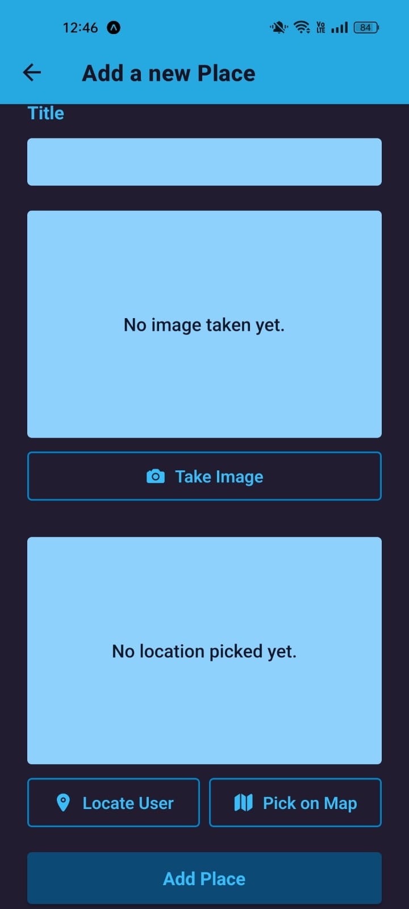
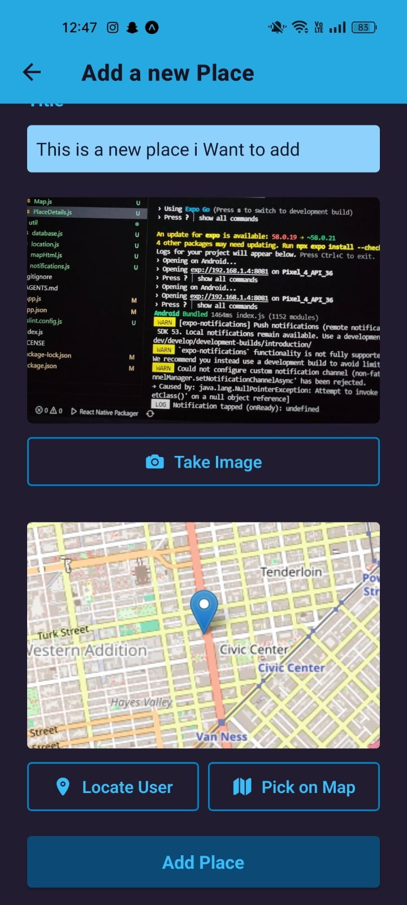
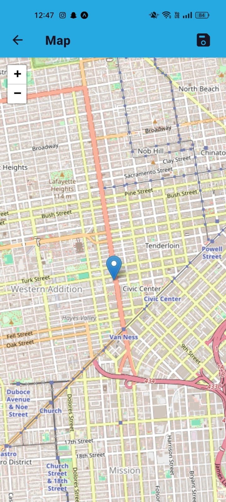
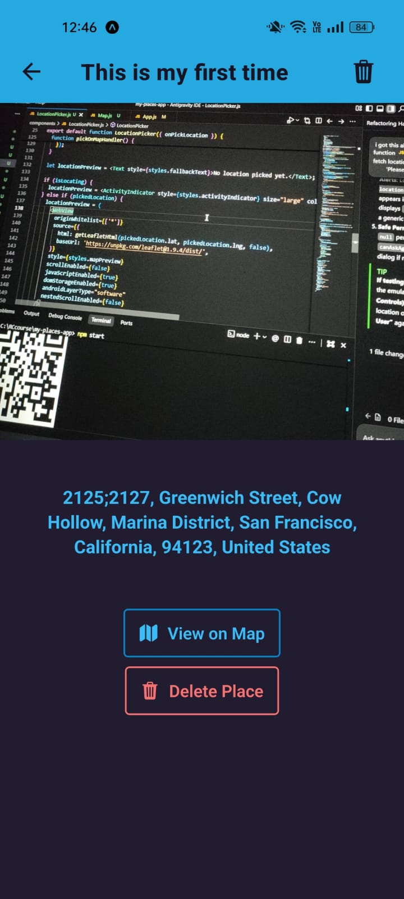
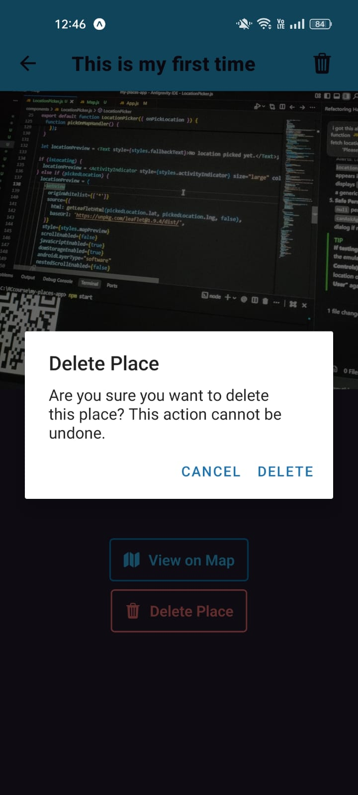
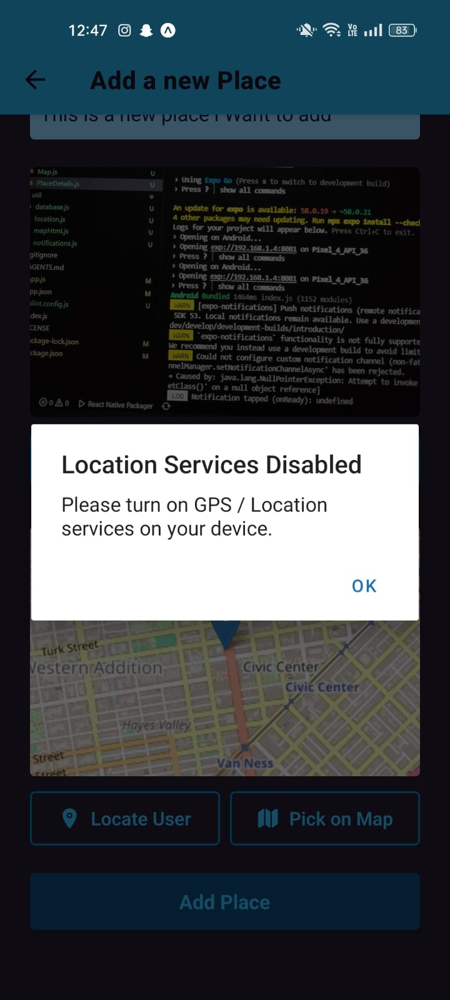
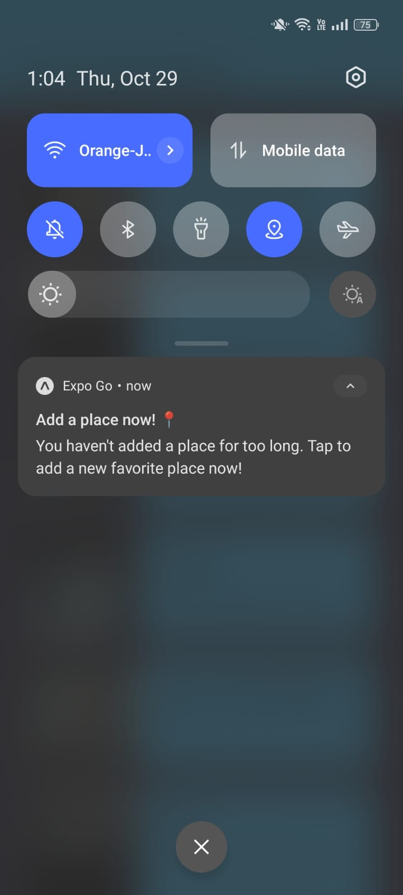

# 📍 Favorite Places — Mobile App

[](https://expo.dev)
[](https://reactnative.dev)
[](https://docs.expo.dev/versions/latest/sdk/sqlite/)
[](https://www.openstreetmap.org)
[](LICENSE)

A modern, offline-first mobile application built with **React Native & Expo SDK 58** that enables users to discover, document, and store their favorite locations. Every saved place is stored with a custom photograph, exact GPS coordinates, an automated reverse-geocoded street address, and interactive map coordinates.

The app is engineered to be 100% **Expo Go compatible** without requiring expensive third-party map API keys or cloud service subscriptions.

---

## 📸 Screenshots Showcase

| All Places (Home) | Add Place Form | Captured Place Data |
|:---:|:---:|:---:|
|  |  |  |
| *Browse saved places with thumbnails & geocoded addresses* | *Clean form with title, camera, and map pickers* | *Live photo preview & embedded map coordinates* |

| Interactive Map View | Place Details & Actions | Delete Confirmation Alert |
|:---:|:---:|:---:|
|  |  |  |
| *OpenStreetMap via Leaflet.js in WebView* | *Full-resolution image, address, and quick actions* | *Native safety prompt before permanent removal* |

| Location Permission Alert | Inactivity Reminder Notification |
|:---:|:---:|
|  |  |
| *Graceful error & permission handling for GPS services* | *Local reminder notification deep-linking directly to Add Place* |

---

## ✨ Features & Capabilities

### 📷 Camera Integration & Persistent Storage
- Directly captures photos using device hardware via `expo-image-picker`.
- Automatic image persistence: temporary camera cache files are safely copied to the application's isolated document directory (`expo-file-system`) before storing their path in SQLite, ensuring photos survive cache cleanups and system reboots.

### 🛰️ Real-Time GPS & Smart Location Detection
- One-tap device GPS location retrieval using `expo-location`.
- Detects disabled location services or rejected permissions with friendly alerts to guide users.

### 🔍 Automated Reverse Geocoding
- Converts raw coordinates (`lat`, `lng`) into human-readable street addresses using **OpenStreetMap Nominatim**.
- Fully compliant with OSM usage policies via custom `User-Agent` headers and event-driven request throttling.

### 🗺️ Interactive Maps (Leaflet.js + WebView)
- **Zero-API-Key Map Solution**: Runs Leaflet.js inside `react-native-webview` rendering OpenStreetMap tiles.
- **Dual-Mode Operation**:
  - **Picker Mode**: Tap anywhere on the map to drop and drag pins, updating coordinates on the fly.
  - **Read-Only Mode**: Launched from Place Details to inspect a saved location with locked controls.
- **State Preservation**: Employs `navigation.popTo` to ensure that returning from map selection preserves all previously filled form state without triggering unmount resets.

### 💾 Offline-First SQLite Database
- Powered by `expo-sqlite` utilizing asynchronous execution (`openDatabaseAsync`, `execAsync`, `runAsync`, `getAllAsync`, `getFirstAsync`).
- Fast, local persistence with immediate UI synchronization upon screen focus (`useIsFocused`).

### 🗑️ Place Details & Deletion Management
- Detailed viewing screen displaying full-bleed photo previews, reverse-geocoded addresses, and one-tap map inspection.
- Native confirmation alerts before deleting records from SQLite to prevent accidental data loss.

### 🔔 Smart Local Inactivity Notifications
- Configured with `expo-notifications` to re-engage users who haven't added a favorite place recently.
- Custom Android notification channel with `MAX` importance and custom vibration patterns.
- Deep-linking support: tapping a notification automatically opens the `AddPlace` screen, whether the app is running in the background or launched cold from a killed state.

### 🛡️ Startup Resilience & Splash Screen Management
- Keeps the native splash screen visible (`expo-splash-screen`) while database migrations and notification channels initialize.
- Dedicated retry fallback error screen (`ErrorScreen.js`) if database initialization encounters filesystem errors.

---

## 🤖 AI Agent Management & Review Workflow

This application was developed through a pair-programming collaboration between the **Human Developer** and the **Antigravity AI Agent**. Development was managed using a structured, plan-driven engineering approach.

### 1. The Master Plan (`docs/implementation_plan.md`)
Prior to writing implementation code, the complete project architecture was documented in [`docs/implementation_plan.md`](./docs/implementation_plan.md). This plan established:
- Color palette tokens (`constants/colors.js`) extracted directly from design mockups.
- Technical decisions (React Navigation stack, Leaflet in WebView, Nominatim geocoding, SQLite schema).
- Screen flow diagrams and sequential execution phases.
- Explicit acceptance criteria for each phase.

### 2. Phased Implementation & Human Review
The agent was guided phase by phase, allowing the human developer to inspect, test, and validate changes before proceeding to the next milestone:

```
[Phase 1: Shell & Navigation] ➔ Human Review (Expo Go navigation test)
           ↓
[Phase 2: UI Design System]  ➔ Human Review (Button & palette styling)
           ↓
[Phase 3: Form & Pickers]    ➔ Human Review (Camera capture & GPS permissions)
           ↓
[Phase 4: Leaflet & WebView] ➔ Human Review (Map marker selection & coordinates)
           ↓
[Phase 5: SQLite Storage]    ➔ Human Review (Data persistence across app reboots)
           ↓
[Phase 6: List & Details]    ➔ Human Review (Feed rendering & details inspection)
           ↓
[Phase 7: Polish & Review]   ➔ Human Review (Error boundaries, styling consistency)
```

### 3. Iterative Problem Solving & Feature Expansion
As testing progressed on real devices, the human developer directed targeted enhancements outside the original baseline:
- **Map Navigation State Fix**: When returning from the map picker reset form inputs, the navigation flow was refactored to use `navigation.popTo` to maintain form data integrity.
- **Record Deletion**: Introduced database deletion routines (`deletePlace`) and native modal confirmation dialogs in `screens/PlaceDetails.js`.
- **Local Notification Reminders**: Designed and implemented an inactivity notification lifecycle in `util/notifications.js` with Android channel configuration and response listener routing in `App.js`.

### 4. Quality Control & Standards (`AGENTS.md`)
The agent was constrained by strict rules defined in [`AGENTS.md`](./AGENTS.md):
- Utilizing modern Expo SDK 58 conventions.
- Never hand-editing generated native directories.
- Verifying code quality with `expo lint` and static checks before marking tasks complete.

---

## 📂 Project Architecture

```
my-places-app/
├── App.js                     # Root entry point: Navigator, DB init, & notification routing
├── index.js                   # Application registerRootComponent
├── app.json                   # Expo application configuration & plugins
├── AGENTS.md                  # Development rules & guidelines for AI collaboration
├── package.json               # Dependencies & scripts
├── docs/
│   └── implementation_plan.md # Architectural plan, phases, and technical decisions
├── constants/
│   └── colors.js              # Theme tokens and color palette
├── models/
│   └── place.js               # Place entity class definition
├── util/
│   ├── database.js            # SQLite database initialization & CRUD queries
│   ├── location.js            # Nominatim reverse-geocoding service
│   ├── mapHtml.js             # Leaflet.js HTML & JS bundle for WebView
│   └── notifications.js       # Expo notification scheduling, channels & permissions
├── components/
│   ├── ErrorScreen.js         # Fallback error screen with retry mechanism
│   ├── ImagePicker.js         # Camera launch, preview, and image handling
│   ├── LocationPicker.js      # GPS locator and map thumbnail launcher
│   ├── places/
│   │   ├── PlaceForm.js       # Complete Add Place submission form
│   │   ├── PlaceItem.js       # Individual place item card
│   │   └── PlacesList.js      # FlatList feed of all saved places
│   └── ui/
│       ├── Button.js          # Primary full-width button
│       ├── IconButton.js      # Header & inline icon button
│       └── OutlinedButton.js  # Outlined action button with icon
├── screens/
│   ├── AllPlaces.js           # Home screen with list of saved places
│   ├── AddPlace.js            # Screen for adding a new place
│   ├── PlaceDetails.js        # Detailed view with photo, map link & delete action
│   └── Map.js                 # Full-screen interactive / read-only Leaflet map
└── assets/
    ├── icon.png               # App icon
    ├── splash-icon.png        # Splash screen graphic
    └── screenshots/           # Application screenshots for documentation
```

---

## 🛠️ Technology Stack

| Technology | Purpose |
|---|---|
| **Expo SDK 58** | Modern universal React application framework |
| **React Native 0.88** | Mobile core runtime |
| **@react-navigation/native-stack** | Native screen navigation and transition transitions |
| **expo-sqlite** | Local offline SQLite database engine |
| **expo-location** | Device GPS and geocoding permissions |
| **expo-image-picker** | Camera and image capture |
| **expo-file-system** | Persistent local sandboxed disk storage |
| **expo-notifications** | Local push notifications, scheduling, and channel control |
| **react-native-webview** | Embedded browser for Leaflet.js map display |
| **Leaflet.js + OpenStreetMap** | Interactive mapping engine with zero API key requirement |

---

## 🚀 Getting Started

### Prerequisites
- [Node.js](https://nodejs.org) (v18 or newer recommended)
- [Expo Go](https://expo.dev/go) installed on your physical iOS or Android device (or an Android/iOS Simulator configured)

### Installation
1. Clone the repository:
   ```bash
   git clone https://github.com/your-username/my-places-app.git
   cd my-places-app
   ```

2. Install dependencies:
   ```bash
   npm install
   ```

3. Start the Expo development server:
   ```bash
   npm start
   # or
   npx expo start
   ```

4. Run the app:
   - Scan the terminal QR code with the **Expo Go** app (Android) or **Camera** app (iOS).
   - Press `a` in the terminal to launch in an Android emulator.
   - Press `i` in the terminal to launch in an iOS simulator.

---

## 🧪 Linting & Quality Verification

Check code syntax and styling:
```bash
npm run lint
# or
npx expo lint
```

---

## 📄 License

This project is licensed under the [MIT License](LICENSE).
