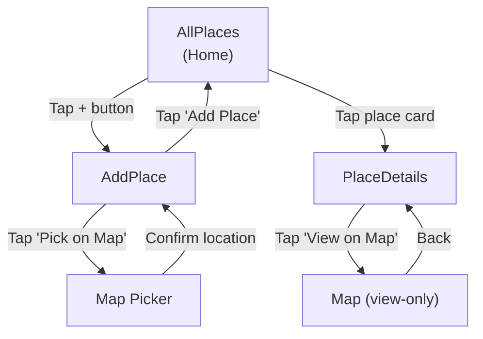
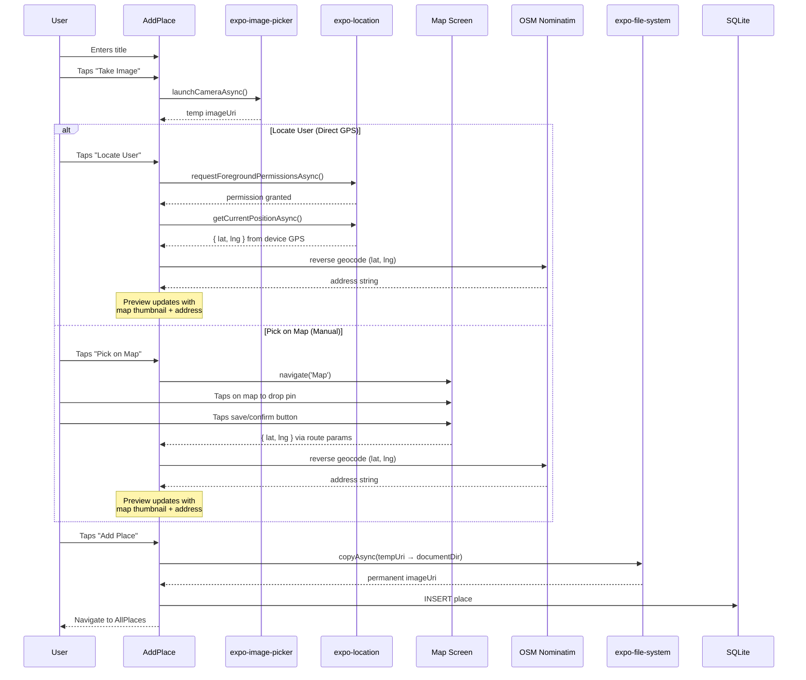

# Favorite Places App — Implementation Plan

## Goal

Build a mobile app using **Expo SDK 58 + React Native** that lets users save, browse, and manage their favorite places. Each place has a title, a photo, and a GPS location with a reverse-geocoded address. Data persists locally in SQLite.

The design follows the uploaded UI screenshots exactly: **dark navy background (`#1a1a2e`)**, **cyan/sky-blue header bar**, **light-blue placeholder cards**, and **outlined cyan buttons**.

---

## UI Reference Summary (from uploaded screenshots)

| Screen | Key Elements |
|---|---|
| **Home (populated)** | Cyan header "Your Favorite Places" + `+` icon. FlatList of place cards: thumbnail image on left, bold title + address on right. Light-blue card background. |
| **Home (empty)** | Same header. Centered text: *"No places added yet - start adding some!"* |
| **Add Place** | Header: `< Back` / "Add a new Place". Sections stacked vertically: Title label + text input → Image preview + "Take Image" button → Map/location preview + "Locate User" & "Pick on Map" buttons → "Add Place" submit button (full-width, solid dark-blue). |
| **Place Details** | Header: `←` + place title. Full-width image. Address text. "View on Map" outlined button. |
| **Map Picker** | Header: `< Add a new Place` / "Map" + save icon (top-right). Full-screen interactive map (OpenStreetMap tiles). |

---

## Technical Decisions

### Navigation
**React Navigation** (`@react-navigation/native-stack`) — chosen per user preference. Single stack navigator with 4 screens.

### Map Strategy
**Leaflet.js + `react-native-webview` + OpenStreetMap tiles** — fully Expo Go compatible, no API keys, no credit card.
- Inject an HTML page with Leaflet into a WebView.
- Communicate between React Native ↔ WebView via `postMessage` / `onMessage`.
- Comply with [OSM tile usage policy](https://operations.osmfoundation.org/policies/tiles/) by setting a custom `User-Agent` header in tile requests.

### Reverse Geocoding
**OpenStreetMap Nominatim** — free, no API key.
```
GET https://nominatim.openstreetmap.org/reverse?lat={lat}&lon={lng}&format=json
```
Rate limit: max 1 request/second. We only call this when a location is picked, so this is fine.

### Image Storage
- `expo-image-picker` captures/picks the photo → returns a temporary URI.
- `expo-file-system` copies the image to the app's **document directory** for persistence.
- The permanent local path is stored in SQLite.

### Expo Go Compatibility ✅
All chosen packages are included in Expo Go for SDK 58:

| Package | Expo Go |
|---|---|
| `expo-sqlite` | ✅ Included |
| `expo-location` | ✅ Included |
| `expo-image-picker` | ✅ Included |
| `expo-file-system` | ✅ Included |
| `react-native-webview` | ✅ Included |
| `@react-navigation/*` | ✅ JS-only + included native deps |

---

## SQLite Data Model

```sql
CREATE TABLE IF NOT EXISTS places (
  id    INTEGER PRIMARY KEY NOT NULL,
  title TEXT    NOT NULL,
  imageUri TEXT NOT NULL,
  address  TEXT NOT NULL,
  lat   REAL   NOT NULL,
  lng   REAL   NOT NULL
);
```

Single table, simple schema. `imageUri` stores the **local file path** on disk (inside the app's document directory).

---

## Project Structure (proposed)

```
my-places-app/
├── App.js                    # Root: NavigationContainer + Stack
├── package.json
├── app.json
├── docs/
│   └── implementation_plan.md# Project plan documentation
├── constants/
│   └── colors.js             # Centralized color palette
├── models/
│   └── place.js              # Place class/model
├── util/
│   ├── database.js           # SQLite init, CRUD operations
│   └── location.js           # Reverse geocoding helper
├── components/
│   ├── places/
│   │   ├── PlaceForm.js      # The full Add Place form
│   │   ├── PlacesList.js     # FlatList of places
│   │   └── PlaceItem.js      # Single place card
│   ├── ui/
│   │   ├── Button.js         # Reusable styled button
│   │   ├── OutlinedButton.js # Outlined cyan button
│   │   └── IconButton.js     # Icon-only button (header +)
│   ├── ImagePicker.js        # Image capture/preview component
│   └── LocationPicker.js     # Map preview + Locate/Pick buttons
├── screens/
│   ├── AllPlaces.js           # Home screen
│   ├── AddPlace.js            # Add Place screen
│   ├── PlaceDetails.js        # Place Details screen
│   └── Map.js                 # Full-screen Map Picker
└── assets/
    └── map.html               # Leaflet HTML for WebView
```

---

## Screen Flow



- **AllPlaces → AddPlace**: via header `+` button
- **AddPlace → Map**: via "Pick on Map" button; returns `{ lat, lng }` as route params
- **AddPlace → AllPlaces**: after successful save; navigates back
- **AllPlaces → PlaceDetails**: tap a place card; passes `placeId` as route param
- **PlaceDetails → Map**: via "View on Map" button; passes `{ lat, lng }` as read-only params

---

## Phases

### Phase 1 — Project Setup & Navigation Shell

**Goal:** Install all dependencies, configure navigation, and create placeholder screens.

**Tasks:**
1. Install navigation packages:
   ```bash
   npx expo install @react-navigation/native @react-navigation/native-stack react-native-screens react-native-safe-area-context
   ```
2. Install feature packages:
   ```bash
   npx expo install expo-sqlite expo-location expo-image-picker expo-file-system react-native-webview
   ```
3. Create the folder structure: `constants/`, `models/`, `util/`, `components/`, `screens/`.
4. Create `constants/colors.js` with the color palette extracted from the screenshots:
   ```js
   export const Colors = {
     primary50:  '#cfeffd',   // light blue (cards, placeholders)
     primary100: '#a4e0fa',
     primary200: '#72ccf1',
     primary400: '#44b4e4',
     primary500: '#1a8dcc',   // mid accent
     primary700: '#0c6b99',
     primary800: '#003557',   // header blue
     accent500:  '#e6b30b',
     gray700:    '#221c30',   // dark navy background
     gray600:    '#2d2846',
   };
   ```
5. Update `App.js` to set up `NavigationContainer` + `NativeStackNavigator` with 4 screens (AllPlaces, AddPlace, PlaceDetails, Map).
6. Style the header globally: cyan background, dark text.
7. Create placeholder screens (each just renders a `<Text>` with the screen name).

**Completion criteria:** App launches, you can navigate between all 4 screens via header buttons and test links. No functionality yet.

---

### Phase 2 — Reusable UI Components & Theming

**Goal:** Build the shared UI components used across screens.

**Tasks:**
1. **[NEW] `components/ui/Button.js`** — Full-width solid button (used for "Add Place"). Props: `onPress`, `children`.
2. **[NEW] `components/ui/OutlinedButton.js`** — Outlined button with icon (used for "Take Image", "Locate User", "Pick on Map", "View on Map"). Props: `onPress`, `icon`, `children`.
3. **[NEW] `components/ui/IconButton.js`** — Icon-only button (used for header `+` and save). Props: `onPress`, `icon`, `size`, `color`.
4. **[NEW] `models/place.js`** — Simple Place class:
   ```js
   export class Place {
     constructor(title, imageUri, location, id) {
       this.title = title;
       this.imageUri = imageUri;
       this.address = location.address;
       this.location = { lat: location.lat, lng: location.lng }; // { lat, lng }
       this.id = id; // Assigned by SQLite AUTOINCREMENT when fetched from DB
     }
   }
   ```
5. Wire the `+` header button on AllPlaces to navigate to AddPlace.

**Completion criteria:** All 3 button variants render correctly with correct styling. Place model is defined.

---

### Phase 3 — Add Place Form (Image Picker + Location Picker)

**Goal:** Build the full AddPlace form UI with working image capture and location selection.

**Tasks:**
1. **[NEW] `components/ImagePicker.js`**
   - Shows a light-blue preview area. If no image: text "No image taken yet."
   - "Take Image" outlined button below.
   - On press: request camera permissions via `expo-image-picker`, launch camera (or gallery).
   - On success: display the image preview in the placeholder area.
   - Expose the picked `imageUri` to the parent via a callback prop.

2. **[NEW] `components/LocationPicker.js`**
   - Shows a light-blue preview area. If no location: text "No location picked yet."
   - If location selected: show a small map preview (Leaflet in a small WebView or a static OSM tile image) centered on the picked coordinates.
   - Two buttons side-by-side: **"Locate User"** | **"Pick on Map"**.
   - **"Locate User" — Direct GPS location (no map needed):**
     1. Requests foreground location permissions via `expo-location.requestForegroundPermissionsAsync()`.
     2. If granted, calls `Location.getCurrentPositionAsync()` to get the device's **current GPS coordinates** (`lat`, `lng`) directly.
     3. Calls `getAddress(lat, lng)` to reverse-geocode the coordinates into a human-readable address via Nominatim.
     4. Updates the preview area to show the map thumbnail at the user's current location.
     5. If permission denied, shows an `Alert` explaining that location access is needed.
   - **"Pick on Map" — Manual map selection:**
     - Navigates to the full-screen Map Picker screen.
     - User taps anywhere on the map to drop a pin.
     - On confirm, returns `{ lat, lng }` via route params back to this component.
     - Reverse-geocodes and updates the preview.
   - Expose `{ lat, lng, address }` to parent via callback prop.

3. **[NEW] `util/location.js`**
   - `getAddress(lat, lng)`: calls Nominatim reverse geocoding API, returns a formatted address string.

4. **[NEW] `components/places/PlaceForm.js`**
   - Wraps: Title `<TextInput>` + `<ImagePicker>` + `<LocationPicker>` + "Add Place" `<Button>`.
   - Manages local state for title, imageUri, and location.
   - Validates all fields are filled before calling `onCreatePlace` callback.
   - Wrapped in a `<ScrollView>`.

5. **[MODIFY] `screens/AddPlace.js`**
   - Renders `<PlaceForm>` and handles the `onCreatePlace` callback (for now just logs; DB save comes in Phase 5).

**Completion criteria:** You can type a title, take/pick a photo (preview appears), get your GPS location or pick on map, and tap "Add Place" (validation works, console logs the data).

---

### Phase 4 — Interactive Map Screen (Leaflet + WebView)

**Goal:** Build the full-screen map picker using Leaflet inside a WebView.

**Tasks:**
1. **[NEW] `assets/map.html`** — Self-contained HTML page with:
   - Leaflet CSS/JS loaded from CDN (`unpkg.com/leaflet@1.9.4`).
   - OpenStreetMap tile layer with proper attribution.
   - On map tap: place/move a marker, send `{ lat, lng }` to React Native via `window.ReactNativeWebView.postMessage(...)`.
   - Receive initial coordinates from React Native via URL params or injected JS.
   - Support read-only mode (no tap interaction) for "View on Map" from PlaceDetails.

2. **[MODIFY] `screens/Map.js`**
   - Renders `<WebView>` loading `map.html` from assets.
   - Header: title "Map", save/confirm button (top-right `IconButton`). Only shown if in pick mode.
   - `onMessage` handler: captures selected `{ lat, lng }` from the WebView.
   - On save: navigate back to AddPlace with `{ lat, lng }` as route params.
   - **Read-only mode** (when coming from PlaceDetails): receives `{ lat, lng }` as params, centers map there with a marker, hides save button.

3. **[MODIFY] `components/LocationPicker.js`**
   - After returning from Map screen, read `route.params.pickedLat` / `route.params.pickedLng`.
   - Call `getAddress()` to reverse-geocode.
   - Update the preview to show a small map thumbnail.

**Completion criteria:** Full-screen map renders with OSM tiles. Tapping places a marker. Save button returns coordinates. "Locate User" button in AddPlace also works. Map works in both pick and view-only modes.

---

### Phase 5 — SQLite Database & Data Persistence

**Goal:** Set up the SQLite database and wire up CRUD operations.

**Tasks:**
1. **[NEW] `util/database.js`**
   ```js
   import * as SQLite from 'expo-sqlite';

   let db;

   export async function init() {
     db = await SQLite.openDatabaseAsync('places.db');
     await db.execAsync(`
       CREATE TABLE IF NOT EXISTS places (
         id INTEGER PRIMARY KEY NOT NULL,
         title TEXT NOT NULL,
         imageUri TEXT NOT NULL,
         address TEXT NOT NULL,
         lat REAL NOT NULL,
         lng REAL NOT NULL
       );
     `);
   }

   export async function insertPlace(place) {
     const result = await db.runAsync(
       'INSERT INTO places (title, imageUri, address, lat, lng) VALUES (?, ?, ?, ?, ?)',
       [place.title, place.imageUri, place.address, place.location.lat, place.location.lng]
     );
     return result.lastInsertRowId;
   }

   export async function fetchPlaces() {
     const rows = await db.getAllAsync('SELECT * FROM places');
     return rows.map(
       (dp) =>
         new Place(
           dp.title,
           dp.imageUri,
           { address: dp.address, lat: dp.lat, lng: dp.lng },
           dp.id
         )
     );
   }

   export async function fetchPlaceDetails(id) {
     const dbPlace = await db.getFirstAsync('SELECT * FROM places WHERE id = ?', [id]);
     if (!dbPlace) return null;
     return new Place(
       dbPlace.title,
       dbPlace.imageUri,
       { address: dbPlace.address, lat: dbPlace.lat, lng: dbPlace.lng },
       dbPlace.id
     );
   }
   ```

2. **[MODIFY] `App.js`**
   - Call `init()` on app startup (before rendering the navigator). Use a loading state / `AppLoading` pattern.
   - Copy picked images to the document directory using `expo-file-system` before inserting into DB.

3. **[MODIFY] `screens/AddPlace.js`**
   - On "Add Place": copy image to document directory → insert into SQLite → navigate back to AllPlaces.

**Completion criteria:** Places are saved to SQLite. App restart preserves data. Image files are stored persistently in the document directory.

---

### Phase 6 — Places List & Place Details Screens

**Goal:** Display saved places on the home screen and implement the details screen.

**Tasks:**
1. **[NEW] `components/places/PlaceItem.js`**
   - Renders a single place card matching the screenshot: image thumbnail (left), title + address (right).
   - Light-blue card background, pressable → navigates to PlaceDetails.

2. **[NEW] `components/places/PlacesList.js`**
   - `<FlatList>` rendering `<PlaceItem>` components.
   - Empty state: centered text *"No places added yet - start adding some!"*

3. **[MODIFY] `screens/AllPlaces.js`**
   - On screen focus (`useIsFocused` or `useFocusEffect`): fetch all places from SQLite.
   - Render `<PlacesList>`.

4. **[MODIFY] `screens/PlaceDetails.js`**
   - Receives `placeId` from route params.
   - Fetches place details from SQLite on mount.
   - Renders: full-width `<Image>`, address text, "View on Map" `<OutlinedButton>`.
   - "View on Map" navigates to Map screen in read-only mode.

**Completion criteria:** Home screen shows all saved places. Tapping a place shows its details. "View on Map" opens the map centered on the place. Empty state works.

---

### Phase 7 — Polish, Validation & Testing

**Goal:** Final styling pass, edge-case handling, and verification.

**Tasks:**
1. **Loading states:** Add `<ActivityIndicator>` spinners while fetching data from SQLite and while reverse-geocoding.
2. **Error handling:** Handle permission denials for camera and location gracefully (show `Alert`).
3. **Keyboard handling:** Wrap AddPlace form in `<KeyboardAvoidingView>` or use `keyboardShouldPersistTaps` on ScrollView.
4. **Style polish:** Ensure all spacing, font sizes, and colors match the screenshots precisely.
5. **StatusBar:** Set status bar to light content for the dark background.
6. Run **lint** (`npx expo lint`) and **typecheck** (`npx tsc --noEmit`) — if TypeScript is configured.
7. Manual testing on Expo Go (Android & iOS):
   - Add a place with photo + GPS location → appears in list
   - Add a place with photo + map-picked location → appears in list
   - Tap a place → see details → View on Map works
   - Kill app → reopen → data persists
   - Empty state renders when no places exist

**Completion criteria:** App is polished, all edge cases handled, matches uploaded UI screenshots.

---

## Dependencies Summary

```bash
# Navigation
npx expo install @react-navigation/native @react-navigation/native-stack react-native-screens react-native-safe-area-context

# Features
npx expo install expo-sqlite expo-location expo-image-picker expo-file-system react-native-webview
```

Total: **7 new packages**. All Expo Go compatible.

---

## Data Flow Diagram



---

## Known Limitations & Notes

> [!IMPORTANT]
> **Leaflet in WebView** — The map is rendered inside a WebView, not a native map component. This means:
> - Slightly slower rendering than a native map
> - Touch gestures (pinch-to-zoom) work but may feel less fluid
> - This is the **correct trade-off** for Expo Go compatibility without API keys

> [!NOTE]
> **Nominatim rate limit** — OpenStreetMap's Nominatim API allows max 1 request/second. Since we only call it when a location is picked (not continuously), this is not an issue. We include a custom `User-Agent` header per their usage policy.

> [!NOTE]
> **Image persistence** — `expo-image-picker` returns a temporary URI that gets cleaned up. We must copy images to `FileSystem.documentDirectory` before storing the path in SQLite. This ensures images survive app restarts.

> [!WARNING]
> **No delete functionality** — The uploaded UI screenshots do not show a delete button. If you want delete support, let me know and I'll add it as an optional phase.

---

## Open Questions

> [!IMPORTANT]
> 1. **Should "Take Image" launch the camera directly, or show a choice between camera and photo gallery?** The screenshots show "Take Image" suggesting camera-only, but gallery access is often useful.

> [!IMPORTANT]
> 2. **Do you want a delete place feature?** The screenshots don't show one, but it's a natural addition.

---

## Verification Plan

### Manual Verification (Expo Go)
1. Fresh install → Home shows empty state ✓
2. Tap `+` → navigate to Add Place ✓
3. Type title, take photo, get GPS location → all fields populate ✓
4. Tap "Pick on Map" → map opens → tap to select → save → returns to form ✓
5. Tap "Add Place" → returns to Home → place appears in list ✓
6. Tap place → details screen with image + address ✓
7. Tap "View on Map" → map opens centered on place (read-only) ✓
8. Kill and restart app → all places still present ✓
9. Test with no permissions granted → graceful error alerts ✓
